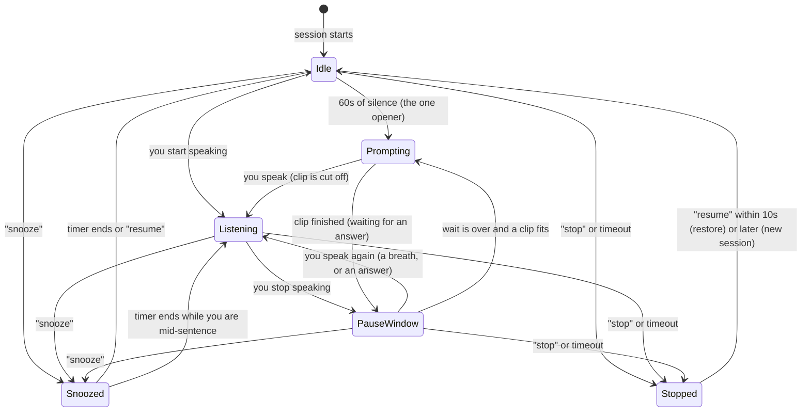
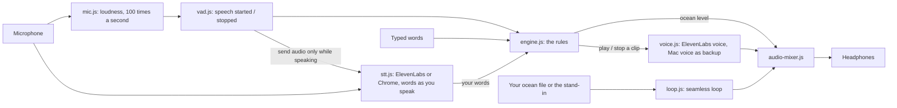
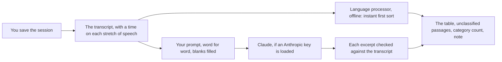

# How it works

This describes one full session, then the six states and what moves the system between them, then how the sound works. As of milestone 3 (part 1) the rulebook, the sound, live transcription and the ElevenLabs voice are real. Saving sessions comes next.

**The guiding idea: calm technology.** People need time to collect a thought, process it, and then say it. So every wait before the system may speak is **at least one full minute**, and the settings won't go lower. Silence is the normal state, not a gap to fill.

## One session, start to finish

1. **You start a session.** The ocean fades in over 3 seconds. The system is in the **Idle** state: it is open, but you haven't said anything.
2. **You say nothing for a full minute.** That is `openerSilenceMs`. The system gives *one* opener for the whole session, chosen in this order: a goal you've worked on recently, then a thought from an earlier session, then "Whenever you're ready. What's on your mind?" If you ignore it, it is never repeated. If you start talking before then, there is no opener at all.
3. **You start speaking.** The state becomes **Listening**. Right away *Voice detection* shows **Speech detected**, the voice bar fills, and the dot next to "Listening" blinks. No sound plays. The ocean turns right down (to 5%). The system is completely silent. Your words appear on screen as you speak.
4. **You stop speaking.** The state becomes **PauseWindow**. First the system waits 1 second (`endOfSpeechBufferMs`) to be sure it was only a breath. If you start again inside that second, nothing happened.
5. **The pause is confirmed.** After 2 seconds of quiet the ocean starts rising back, gradually, over 3 seconds. At 5 seconds of quiet your after-you-speak sound plays (your file, or the built-in one). If your last sentence was finished, those 5 seconds also mean the thought is complete: it is **captured** as a reflection, a task or a goal, and shown in the Captured list. Then the system reads the end of what you said and picks how long to wait before it may speak:
   - finished sentence: **60 seconds**
   - ended on "and", "because", "so", "but" or a filler like "um": **90 seconds**
   - a question you asked yourself ("what else did I think about?"): **90 seconds**, and it will not answer it
6. **The wait runs out.** The system chooses **one** thing to say, or nothing:
   - a plan or task: a planning question ("What might be a gentle first step with that?")
   - a finished but unresolved thought: a reflective question
   - an unfinished thought: a backchannel ("Go on.")
   - something emotional or heavy, or a self-critical line: only a soft "Mm." or "I'm here." and never a question
   - you decided something yourself ("I think I'll just start it as a rant"): an offer to pin it as a task
   - clearly wrapped up: a closer ("Does that feel like everything, for now?")
   - a question you asked yourself, or nothing said yet: silence
7. **The state becomes Prompting.** If the line is a question, a soft cue plays first, then a short gap, then the line. The clip plays. The ocean sits at 35% underneath it. If you start speaking while it plays, the clip is cut off immediately.
8. **The clip finishes.** The system goes back to waiting, now for **90 seconds** (`backoffAfterUnansweredMs`) for an answer. If you speak, that counts as an answer and everything resets.
9. **If you don't answer,** it may speak once more, but never another question: it uses a gentle line from its own set ("I'm still here, whenever you're ready."), separate from the nudge after an unfinished thought. After two unanswered prompts in a row it offers a snooze **once** ("That's okay, no pressure. Want me to snooze for a bit?") and then stays quiet until you speak. A session never ends by itself.
10. **You say a command, on its own:**
    - "snooze" (20 minutes) or "snooze for ten minutes": the system confirms ("Snoozed. Ten minutes."), the ocean fades out, and it is fully silent. Only "resume" is listened for. When time is up, the ocean fades back in.
    - "scratch that" removes the last 3 minutes ("scratch the last five minutes" for 5). The removed material is never mentioned again.
    - "stop" ends and saves ("Saved. Seven thoughts."). For 10 seconds, "resume" undoes it ("Back again. Nothing was lost."). After that, "resume" starts a new session.

What it actually says in each of these moments is up to you: every moment has its own card on the **Wording** tab.

A command only counts when it is your whole utterance with a pause before it, and only 1 to 4 words (6 with a number). "I stopped because I wanted to take notes" is just you talking.

A **thought** is what you say until a finished sentence is followed by 5 seconds of quiet. An unfinished sentence ("...and") keeps the thought open until the 90 s wait passes, so a long think in the middle of a sentence stays one thought. Snooze, stop and a 2-minute silence also close the thought in progress. "Saved. Seven thoughts." counts the Captured list.

**What kind of thought?** Phrases like "this year", "my goal", "I'd love to" make it a **goal**. Phrases like "I need to", "I should", "I'll just" make it a **task**. Everything else is a **reflection**. Both lists are in Settings, under "Word lists the rules use". "Scratch that" also removes captured thoughts from the window. "Saved. Seven thoughts." counts these.

## The six states

(GitHub and VS Code show this as a picture. If you only see code, paste it into mermaid.live.)

| State | What the system is doing | What moves it on |
|---|---|---|
| **Idle** | Session open, nothing said. Counting toward the opener. | You speak; 60 s passes; a command |
| **Listening** | You are speaking. System is silent, transcribing only. | You stop speaking; a command |
| **PauseWindow** | You've stopped. Buffer, then the wait. Silent. | You speak; the wait ends; a command |
| **Prompting** | One clip is playing. | You speak (cut off); the clip ends |
| **Snoozed** | Fully silent. Only "resume" is heard. | Timer ends; "resume" |
| **Stopped** | Session closed. 10 s undo window, then saved. | "resume" |

## How the sound and words work

**Hearing that you speak.** The microphone is measured about 100 times a second. At the start the detector spends 0.6 s learning how loud the quiet room is (the *noise floor*) and keeps adjusting it. Speech **starts** when the sound stays at least 12 dB above the floor for 60 ms; a tap or click is shorter than that and is ignored. Speech **stops** when it has been near the floor for half a second; the short gaps between words are shorter than that, so they don't count. The stop is reported as happening when the quiet began, so the 1 s breath buffer and the 60 s wait are still counted from the real moment you went quiet.

**The ocean's five levels.**

| What happened | Ocean goes to | How fast |
|---|---|---|
| Session starts, or a snooze ends | 60% | fades in over 3 s |
| You start speaking | 5% | 200 ms, fast at first |
| 2 s after you stop | back to 60% | gradually, over 3 s: the "I heard you" |
| A system clip plays | 35% | 200 ms |
| Snooze or stop | silent | fades out over 3 s |

Every change is a smooth curve. If a new change arrives halfway through an old one (you start speaking again while the ocean is rising), it carries on from wherever the volume actually is, so there's never a jump or click.

**The loop.** When a recording is loaded, its last 3 seconds are blended into its first 3 seconds using an equal-power crossfade, and the loop is shortened by those 3 seconds. The browser's audio system then repeats it sample-exactly, so there is no gap and no drift however long the session runs.

**The soft sound after you speak.** Nothing plays when you start speaking. Once you have been quiet for 5 seconds (`pauseCueAfterMs`), one soft sound plays, by which time the ocean is fully back. If a thought was saved in that same pause, its saved tone plays instead, so there is only ever one sound. It never plays while snoozed, stopped or while the system is speaking. You can choose your own file for it (*After-you-speak sound*), and switch it off in the controls. The tiny per-kind saved tones are off unless you turn on `savedCueEnabled`.

**Clips and the voice.** Each line is turned into speech by ElevenLabs in voice U9VgC8Xinl7nnNsyDd3J, using the key from your .env file. At the start of a session every fixed line is made once and kept in the browser, so it plays instantly. The audio goes through the mixer, so talking over it fades it out in 150 ms. If ElevenLabs can't be used, the page says why once and the Mac's built-in voice speaks instead. While a line plays, the ocean sits at 35% and the speech detector becomes 10 dB less sensitive, so the system's own voice doesn't count as you talking. If you start speaking anyway, the clip stops at once.

**Turning speech into words.** The language is set to English (`sttLanguage`), which is more accurate than letting the service guess. Nearly a second of sound from before you started (`sttPreRollMs`, 800 ms) and a little after you stop (`sttPostRollMs`, 600 ms) is included, so first and last words aren't clipped. With ElevenLabs, nothing is sent while you are silent. The moment the detector notices you speaking, the page asks ElevenLabs for a one-time pass (made from the key in your .env file), opens a live connection, and sends your audio in tenth-of-a-second pieces, starting half a second before you began so your first word isn't clipped. Words in progress appear in grey; when you stop, the page says "that's the end of this bit" and the final words replace them. The final words go to the rules, exactly as typed words did before. A command like "snooze for ten minutes" now works by voice. After a minute of silence the connection closes, and it reopens when you speak. With Chrome's built-in option, Chrome listens and returns words by itself.

**Making the words more accurate.** The live connection also sends your *Words to listen for* (up to 50) and asks ElevenLabs to filter out background voices. Meanwhile the page keeps the session's sound in this tab's memory, and notes every stretch the detector heard you speaking (not while snoozed; "scratch that" removes the scratched ones). When you save, before sorting, the whole recording goes once to ElevenLabs' standard model, Scribe v2, which returns every word with its time. Each word is put back into the stretch it was spoken in; words that fall outside every kept stretch (scratched, snoozed, or noise) are thrown away. Stretches the live connection missed completely are filled in too. The better words replace the live ones under *What you said*, and sorting uses them. If this step fails (no key, no credits, no connection), the live words are used and the page says why.

**When something fails.** It never fails silently.
- The microphone is blocked, missing or unplugged: the page shows what to do, and the system says "I can't hear the microphone right now."
- The connection drops while you're mid-sentence: "I lost the last bit. Say it again?"
- The key is missing or refused, or the credits ran out: the page explains, and the system says "I can't catch your words right now." It says this at most once every 30 seconds.

## What the screen shows

The water on the Session screen is drawn live (seascape.js), in the colours of the Wander session frame: twelve soft bands of blue under a cool sky, moving in low, slow swells (about 7 seconds each), each a mix of a long swell, a shorter cross-wave and a small ripple, travelling in alternating directions. One full swell takes about 2.3 seconds, as in the recording. The waves are **audio reactive**: while you speak, your microphone level lifts and settles them; while you are quiet, the ocean's swells (measured against its own recent average) do, and so does the system's voice when it speaks.

| What is happening | The water | The boats |
|---|---|---|
| You are speaking (state Listening) | small, slow swells, lifted by your voice | a new one sails in every 40 words |
| You are quiet, the system is listening | the full swell, moved by the ocean sound | stay where they are, tilting with the waves |
| A thought is captured | (no change) | one sails in from outside the frame, with the tiny saved sound and a tag above it saying what happened ("converted to a task", "set a goal", "added to reflections") |
| "Scratch that" | (no change) | the scratched thoughts' boats sail away |
| Stopped or snoozed | completely still | still, wherever they were, even mid-sail |

Changes ease in over a second or two, so the water never jumps. There are never more than 10 boats. If your Mac is set to reduce motion, the waves move less.

## Sorting a saved session

1. **The transcript.** Everything you said this session (anything you scratched is already gone), one line per stretch of speech, each starting with its time since the session began, like `[04:12]`.
2. **The offline sort, first.** The language processor splits the transcript into sentences, groups them into passages (a silence of 6 s or a phrase like "anyway" or "another thing" starts a new one), then reads each sentence: "I need to / have to / will" + an action is a committed task; "I could / might / maybe I'll" a proposed one; "I want to / hope to" + an outcome a goal; feelings and realisations about yourself a reflection; questions and general claims a concept; a run of past events in order a story; a rule to live by in your exact words a quote. Neighbouring reflective sentences become one reflection, not several. A goal and a step said together are linked; a story and the realisation it leads to are separate and linked. Questions to yourself ("what else did I want to say?") and trailing fragments are listed as unclassified, with the reason.
3. **Claude, with your prompt.** If an Anthropic key is loaded, your prompt goes to Claude unchanged except for its two blanks and one closing line asking it to answer through a form with your table's columns. Its answer replaces the offline sort. Each excerpt is looked up in the transcript; any not found word for word is underlined.
4. **While you speak**, the same language processor reads each captured thought for its tag, across all six kinds. If the wording gives no clear cue, the simple word lists decide, as before.

## Where the code is

The whole rulebook is `js/engine.js`. It never reads the real time and never plays sound; it is given a clock and reports "actions" (play this clip, turn the ocean down, here is a narration line). That is why the tests can run a 20-minute snooze in a blink, and why the later audio milestones can plug in without changing any rule.
